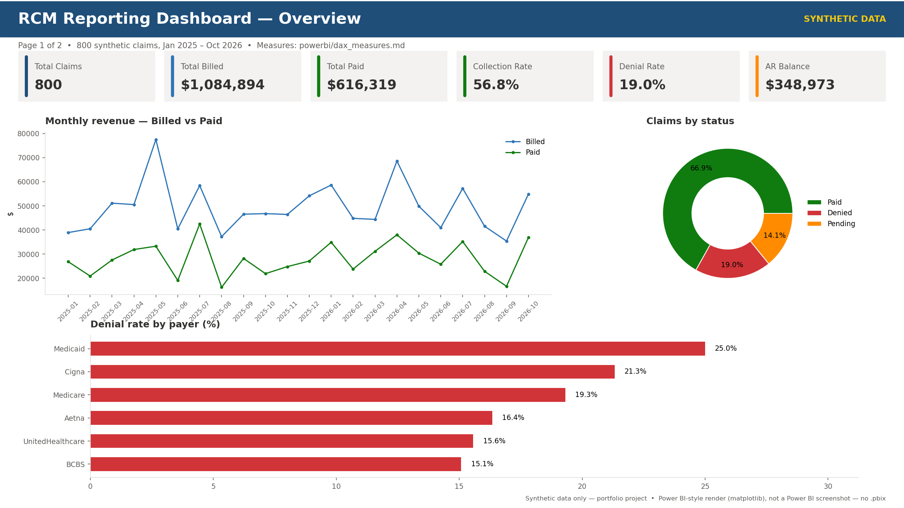
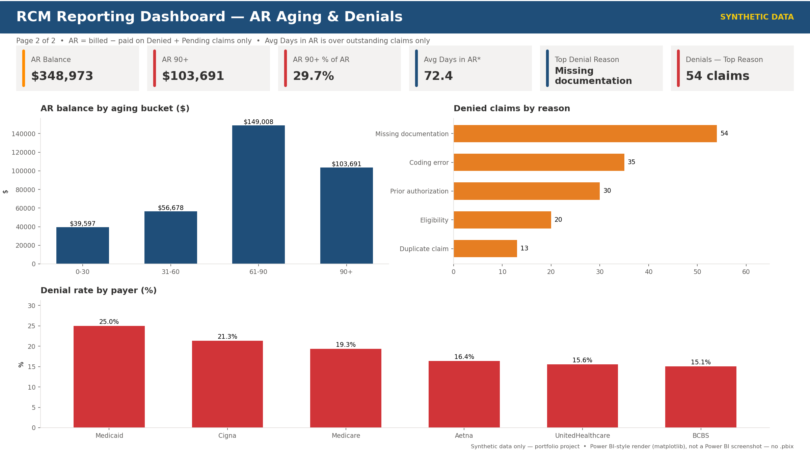
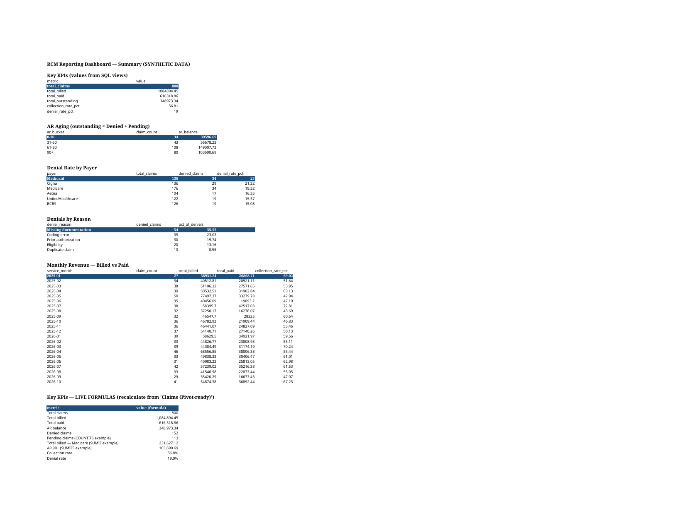
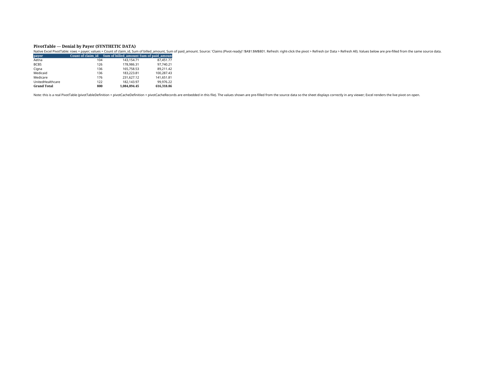
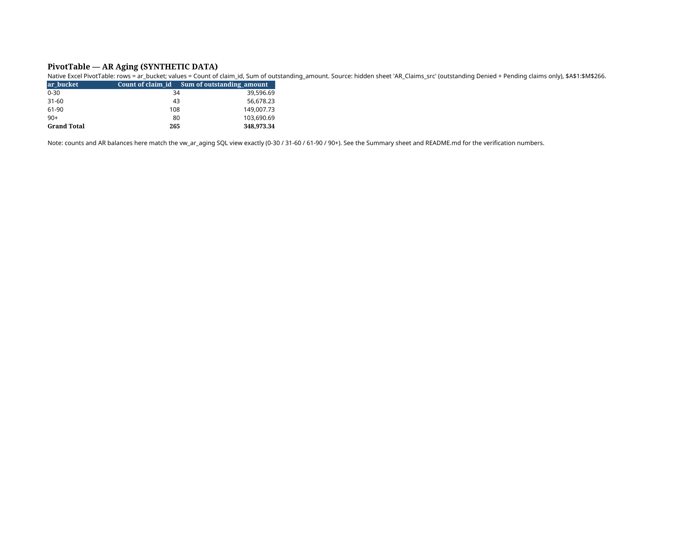
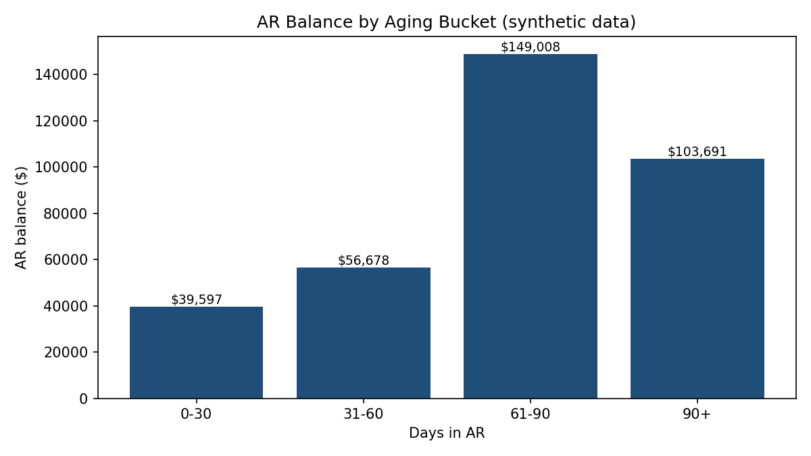
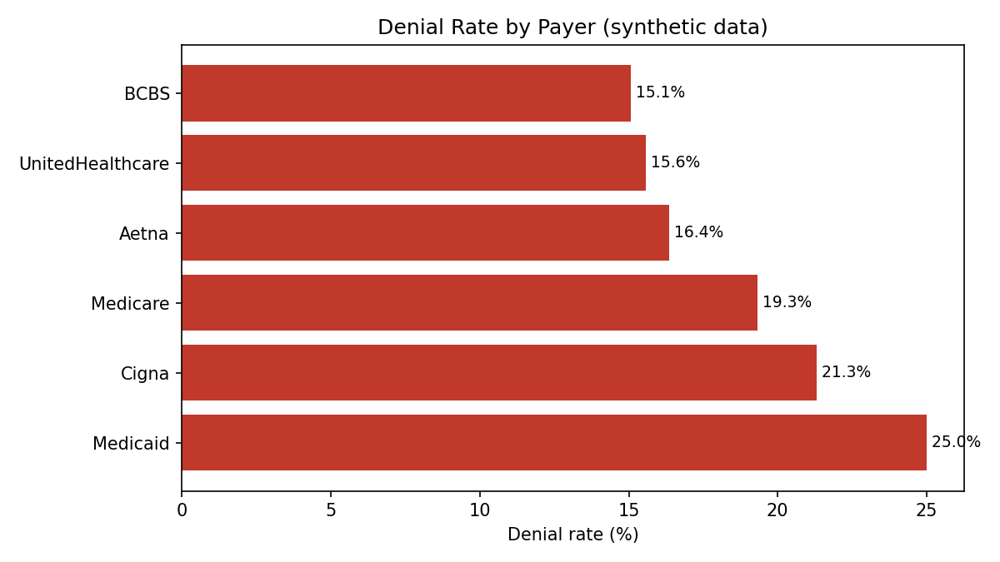
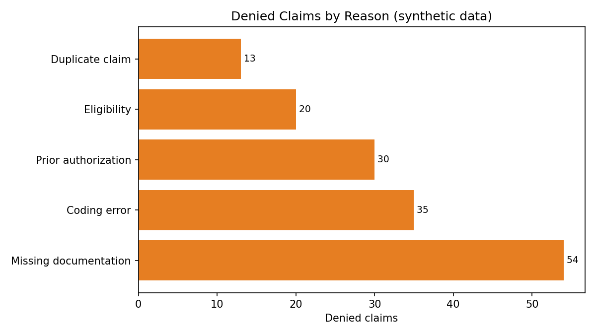
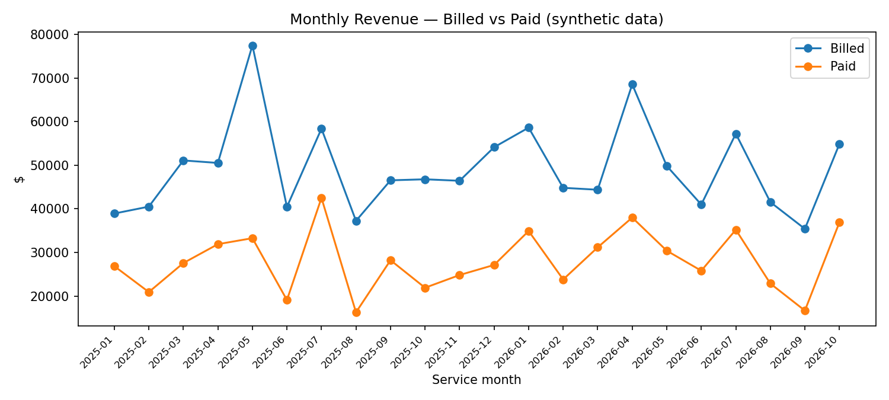

# RCM Reporting Dashboard — Synthetic Medical Billing Claims

> **⚠️ SYNTHETIC DATA ONLY.** Every claim in this project is invented
> (seeded generator, seed 42). There are no real patients, no real claims,
> no real payer data, and no protected health information. Patient IDs are
> fake (`P0001`, `P0002`, …) and no names are included anywhere.
>
> The author has **no prior RCM / medical billing work experience** — this
> project was built to learn RCM reporting (AR aging, denial analysis,
> collection rate) on synthetic data. Nothing here claims otherwise.

A portfolio project by **Muhammad Talha Zahid** — BS Computer Science
(Allama Iqbal Open University, 2020–2024); Operations Analyst, Honda
Downtown Rawalpindi (May 2025–Aug 2026; Power BI, DAX, Power Query, SQL,
Excel); freelance Data Scientist & Analyst on Fiverr since Aug 2023
(180+ projects). Goal: Reporting Analyst in medical billing / RCM, then
Data Scientist.

## Results (from the actual test run — no invented numbers)

| KPI | Value |
|---|---|
| Total claims | 800 |
| Total billed | $1,084,894.45 |
| Total paid | $616,318.86 |
| Collection rate | 56.81% |
| Denial rate | 19.0% (152 denied of 800) |
| AR balance (Denied + Pending) | $348,973.34 |
| AR 90+ | $103,690.69 (80 claims, 29.7% of AR) |
| Status split | Paid 535 · Denied 152 · Pending 113 |
| Avg days in AR (outstanding claims) | 72.4 |

AR aging (buckets sum exactly to the AR balance — verified, see below):

| Bucket | Claims | AR balance |
|---|---|---|
| 0–30 days | 34 | $39,596.69 |
| 31–60 days | 43 | $56,678.23 |
| 61–90 days | 108 | $149,007.73 |
| 90+ days | 80 | $103,690.69 |
| **Total** | **265** | **$348,973.34** |

Denial rate by payer: Medicaid 25.0%, Cigna 21.3%, Medicare 19.3%,
Aetna 16.4%, UnitedHealthcare 15.6%, BCBS 15.1%. Top denial reason:
**Missing documentation**, 54 claims (35.5% of denials), followed by
Coding error (35), Prior authorization (30), Eligibility (20),
Duplicate claim (13).

## Screenshots

### Power BI dashboard — Overview (Page 1)



### Power BI dashboard — AR Aging & Denials (Page 2)



### Excel workbook — Summary sheet



### Excel workbook — PivotTable: Denial by Payer



### Excel workbook — PivotTable: AR Aging



### Charts (matplotlib, from the same data)






## How the screenshots were produced (honest notes)

- **Power BI images** (`screenshots/powerbi_overview.png`,
  `screenshots/powerbi_ar_denials.png`): rendered with **matplotlib** by
  `src/build_dashboards.py`, laid out like the dashboard in
  `powerbi/dashboard_spec.md` and built from the real numbers in
  `claims.db`. They are **not screenshots of Power BI Desktop**.
- **Excel images** (`screenshots/excel_*.png`): rendered from the **actual
  `.xlsx` file** — LibreOffice 24.2 headless converts the workbook to PDF
  (`src/render_workbook.py`), and the Summary / Pivot pages are exported
  as PNGs. The live-formula values you see are LibreOffice's own
  calculation of the workbook's formulas.
- **Charts** (`charts/*.png`): matplotlib, straight from the SQL views.

## What the Power BI deliverable actually is — read this first

**No `.pbix` file was created, and Power BI Desktop was not used.**
The Power BI deliverable in this project is:

1. `powerbi/dax_measures.md` — DAX measures (Total Billed, Total Paid,
   Collection Rate, Denial Rate, AR Balance, AR 90+, AR Bucket calculated
   column, and supporting measures).
2. `powerbi/dashboard_spec.md` — the dashboard spec: 4 pages (Overview,
   AR Aging, Denials, Payer Performance), what each visual shows, filters,
   and slicers.
3. `screenshots/powerbi_overview.png` and
   `screenshots/powerbi_ar_denials.png` — matplotlib renders of pages 1
   and 2 of that spec, built from the real synthetic data.

To build the real thing: load `claims` into Power BI (import
`data/claims_raw.csv` or connect to the SQLite DB), paste the measures
from `dax_measures.md`, and follow `dashboard_spec.md`. Nothing here
pretends that step has already been done.

## Excel workbook — real PivotTables and formulas

File: `excel/RCM_Reporting_Dashboard.xlsx` (7 sheets).

- **PivotTables (native, not flat tables).** Two real Excel PivotTables
  are embedded in the file, built by `src/pivot_utils.py` with openpyxl:
  `Pivot — Denial by Payer` (rows = payer; Count of claim_id, Sum of
  billed_amount, Sum of paid_amount) and `Pivot — AR Aging` (rows =
  ar_bucket; Count of claim_id, Sum of outstanding_amount). Each one has
  the full native structure — `pivotTableDefinition`,
  `pivotCacheDefinition` (shared items per field) and `pivotCacheRecords`
  (one record per source row) — plus `refreshOnLoad`, so Excel rebuilds
  the pivot from the source range on open. Refresh in Excel with
  right-click → Refresh (or Data → Refresh All).
  - The pivot output cells are **also pre-filled** with the true values
    computed from the same source data (cross-checked against the SQL
    views by `src/check_pivots.py`). This is deliberate and disclosed:
    LibreOffice 24.2 in this sandbox does **not** render the pivot
    definition on import (verified across four XML variants, including
    Excel-style cleanups; LO drops the pivot and shows an empty sheet),
    so the pre-filled values make the sheets display correctly in any
    viewer. Excel renders the live pivot over those cells on open.
    The pivot values themselves are real — they match the SQL views
    exactly (see Verification).
  - The AR pivot is sourced from the hidden helper sheet `AR_Claims_src`
    (outstanding Denied + Pending claims only, 265 rows), so its counts
    are outstanding-claim counts, not all-claim counts.
- **Live formulas (Summary sheet).** A "live formulas" block recalculates
  from the Claims sheet: `COUNTA`, `SUM`, `COUNTIF`, `COUNTIFS`,
  `SUMIF` (Total billed — Medicare), `SUMIFS` (AR 90+), plus Collection
  rate and Denial rate as ratios of those cells. Verified: the formula
  results equal the SQL view values (e.g. Total billed $1,084,894.45,
  AR balance $348,973.34, Collection rate 56.8%, Denial rate 19.0%).
- **VLOOKUP / XLOOKUP (Lookup sheet).** Type a claim_id in `B2`
  (default `CLM-0001`) and 11 fields are pulled from the Claims sheet —
  once with `VLOOKUP`, once with `XLOOKUP`. Verified in LibreOffice:
  the VLOOKUP block returns the correct row (Cigna, 99214, K21.9,
  2025-02-02, $796.32 billed, $607.19 paid, Paid, 38 days in AR).
  The XLOOKUP block needs Excel 2021 / Microsoft 365 — LibreOffice 24.2
  shows `#NAME?` for XLOOKUP (support was added in LibreOffice 25.2);
  the formulas are valid in Excel and this is noted on the sheet itself.
- **Claims (Pivot-ready).** All 800 claims as a formatted Excel Table,
  plus two helper columns computed from each claim: `ar_bucket`
  (0-30 / 31-60 / 61-90 / 90+) and `outstanding_amount` (billed − paid
  for Denied/Pending, else 0).

## How to run

```bash
pip install -r requirements.txt        # pandas, numpy, matplotlib, openpyxl
python src/generate_claims.py          # 800 synthetic claims -> data/claims_raw.csv (seed 42)
python src/etl.py                      # load into claims.db (SQLite), idempotent
python src/build_charts.py             # charts/*.png
python src/build_excel.py              # excel/RCM_Reporting_Dashboard.xlsx
python src/check_pivots.py             # structural + values check of the PivotTables
python src/build_dashboards.py         # screenshots/powerbi_*.png
python src/render_workbook.py          # screenshots/excel_*.png (needs LibreOffice + poppler)
```

Re-running `generate_claims.py` reproduces the identical CSV
(md5-verified), and re-running `etl.py` inserts **0** new rows — the load
is idempotent (`claim_id` primary key, `INSERT OR IGNORE`).

## Architecture

```
data/claims_raw.csv            800 synthetic claims (seeded)
claims.db                      SQLite: claims + dq_log tables
src/generate_claims.py         synthetic data generator
src/etl.py                     CSV -> SQLite, validates, logs rejects to dq_log
src/pivot_utils.py             native Excel PivotTable builder (openpyxl)
src/build_excel.py             workbook: Table, Summary, 2 pivots, Lookup, README
src/check_pivots.py            pivot + formula verification
src/build_charts.py            matplotlib charts
src/build_dashboards.py        Power BI-style dashboard images
src/render_workbook.py         LibreOffice render of the workbook sheets
sql/schema.sql                 SQLite DDL
sql/schema_postgres.sql        PostgreSQL DDL (NOT tested — see below)
sql/views.sql                  vw_ar_aging, vw_denial_rate, vw_denial_by_reason,
                               vw_payment_summary, vw_revenue_by_month
powerbi/dax_measures.md        DAX measures
powerbi/dashboard_spec.md      dashboard page/visual spec
excel/RCM_Reporting_Dashboard.xlsx
charts/  screenshots/
```

**AR definition used everywhere:** AR (accounts receivable) = billed −
paid on claims that are not yet paid, i.e. status `Denied` or `Pending`.
Paid claims contribute $0 to AR (the uncollected slice of a Paid claim is
a payer write-off / contractual gap, not money owed). That is why the
four AR buckets sum exactly to the AR balance, and why
`vw_payment_summary.total_outstanding` equals the AR balance.

## Verification (test run, 17 Nov 2026)

- Generate + ETL end-to-end: 800 rows read, 800 inserted, 0 rejected,
  0 in `dq_log`. Re-run: 0 inserted, 800 duplicates ignored, total stays 800.
- Reproducibility: regenerating the CSV gives the identical file (md5 match).
- AR buckets sum: $39,596.69 + $56,678.23 + $149,007.73 + $103,690.69
  = $348,973.34 = AR from claims = `total_outstanding`. ✓
- Data-quality path: a deliberately bad row (unknown payer, paid > billed)
  was rejected to `dq_log` with a reason and not loaded.
- `src/check_pivots.py`: **29 checks passed** — pivot parts present,
  2 caches in workbook.xml, cache-field/shared-item/record counts and
  index ranges, row/col/data field and item counts, location ranges,
  pre-filled pivot values equal to an independent recomputation **and**
  to the SQL views, 11 VLOOKUP + 11 XLOOKUP formulas, 10 live-formula
  cells on Summary.
- LibreOffice render: the workbook converts to PDF cleanly (59 pages,
  Claims sheet excluded from screenshots); Summary formulas calculate to
  the SQL values; VLOOKUP lookup for CLM-0001 matches the database row.

## What was NOT tested

- **PostgreSQL:** `sql/schema_postgres.sql` is a DDL port of the same
  tables/views. It was **not** run against a live PostgreSQL server —
  no server / `psql` exists in this environment (checked: `which psql
  postgres` returns nothing). Do not claim it was tested.
- **Excel itself:** the workbook was verified structurally and rendered
  with LibreOffice 24.2 (see the PivotTable note above). It was **not**
  opened in Microsoft Excel here, so the live-pivot render in Excel is
  expected (refreshOnLoad is set) but not directly observed.
- **Power BI Desktop:** no `.pbix` was built and no dashboard was opened
  in Power BI Desktop (see "What the Power BI deliverable actually is").

## Project structure

```
rcm-reporting-dashboard/
├── README.md
├── requirements.txt
├── claims.db
├── data/claims_raw.csv
├── src/            generate_claims.py, etl.py, pivot_utils.py, build_excel.py,
│                   check_pivots.py, build_charts.py, build_dashboards.py,
│                   render_workbook.py
├── sql/            schema.sql, schema_postgres.sql, views.sql
├── powerbi/        dax_measures.md, dashboard_spec.md
├── excel/          RCM_Reporting_Dashboard.xlsx
├── charts/         ar_aging.png, denial_rate_by_payer.png, denial_reason.png,
│                   monthly_revenue.png
└── screenshots/    powerbi_overview.png, powerbi_ar_denials.png,
                    excel_summary.png, excel_pivot_denial_by_payer.png,
                    excel_pivot_ar_aging.png
```
